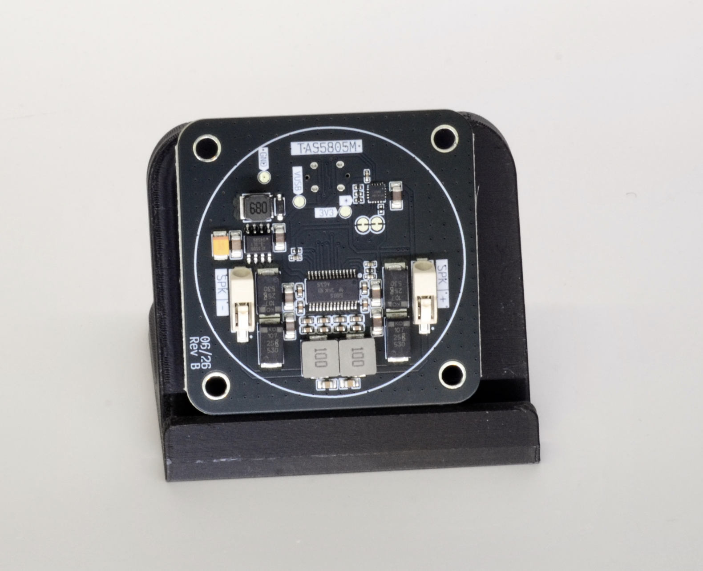
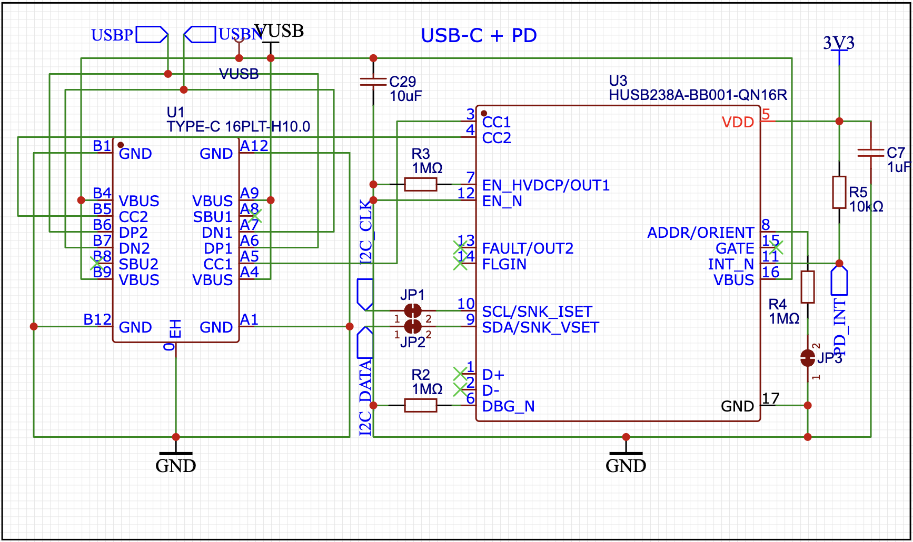
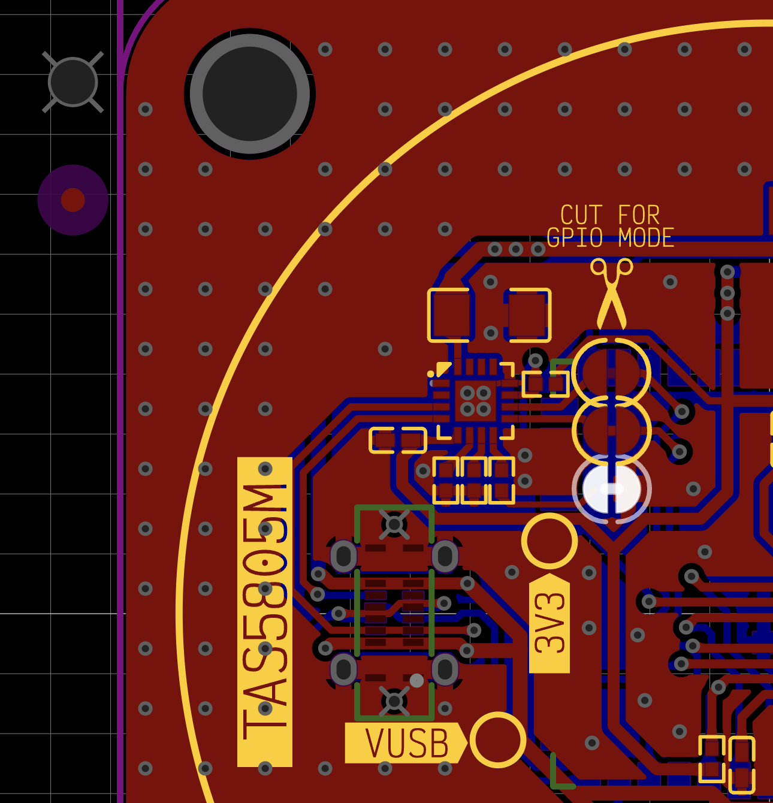

# esphome-husb238a

An [ESPHome](https://esphome.io) external component for the **Hynetek HUSB238A** USB-PD sink controller.



## Why this exists

ESPHome already has a `husb238` component, but it targets the plain **HUSB238** chip's register
map (addresses `0x00`-`0x09`). The **HUSB238A** is a different, pin-similar part with a much larger
register map (`0x00`-`0x91`) and, critically, gates every command (`REQUEST_PDO`, `GET_SRC_CAP`,
`HARD_RESET`, ...) behind a `CONTROL1.ENABLE` bit that doesn't exist on the plain chip. Talking to a
HUSB238A using the plain HUSB238's addresses looks like it works — every I2C read and write is
ACKed — but nothing actually happens: voltage selects silently no-op, and source capabilities never
populate.

This component targets HUSB238A's real register layout and sets the `ENABLE` bit during `setup()`,
so voltage selection and capability discovery actually work.



## Installation

Reference it as an external component in your ESPHome YAML:

```yaml
external_components:
  - source: github://sonocotta/esphome-husb238a
    components: [ husb238a ]
```

## Configuration

```yaml
i2c:
  sda: GPIO8
  scl: GPIO9

husb238a:
  id: husb_01
  address: 0x42  # 0x42 when ADDR/ORIENT is tied to GND, 0x62 when tied to VDD
  update_interval: 1s

binary_sensor:
  - platform: husb238a
    attached: "USB-PD Attached"

sensor:
  - platform: husb238a
    voltage: "Contracted Voltage"
    current: "Contracted Current"
    selected_voltage: "Selected Voltage"

text_sensor:
  - platform: husb238a
    status: "Last request status"
    capabilities: "Capabilities"

select:
  - platform: husb238a
    voltage: "Voltage selector"
```

### ESPhome UI


### Wiring notes

The `ADDR/ORIENT` pin must be tied to `GND` or `VDD` (through the datasheet's recommended ~900kΩ
resistor) for the chip to boot into I2C mode at all — leaving it floating puts the chip into a
resistor-strapped GPIO mode where I2C is disabled entirely.



## Entities

| Platform | Key | Description |
|---|---|---|
| `binary_sensor` | `attached` | Whether a USB-PD source is currently attached |
| `sensor` | `voltage` | Actual contracted voltage from the source |
| `sensor` | `current` | Actual contracted current from the source |
| `sensor` | `selected_voltage` | Voltage currently requested via `SRC_PDO` (may differ from `voltage` while a request is in flight) |
| `text_sensor` | `status` | Whether the last PD message exchange (`AMS`) succeeded |
| `text_sensor` | `capabilities` | Every voltage/current PDO the attached source advertises |
| `select` | `voltage` | Request a specific fixed voltage (`5V`/`9V`/`12V`/`15V`/`20V`) from the source |

### Voltage persistence

The chip itself forgets any requested voltage across a power cycle or hard reset and renegotiates
its Type-C default (5V). The driver works around this by saving the last requested voltage to flash
and re-requesting it during `setup()`, so a reboot restores the previous voltage instead of silently
dropping back to 5V. The `voltage` select also now reflects whatever `SRC_PDO` actually reports on
every poll, instead of only updating in response to a user's own selection (which used to leave it
showing "Unknown" until touched).

## Start-up behaviour and the Hard Reset trap

`CONTROL1.ENABLE` does not just unlock `GO_COMMAND`: with the bit clear the chip's whole PD policy
engine is off (datasheet, *Enable Control*) and the board runs on the Type-C 5 V default. Setting the
bit makes the chip attach as a PD sink and wait for `Source_Capabilities`.

A source only advertises its capabilities for a few seconds after the plug goes in. If the driver
enables the chip later than that (typically right after flashing, or on any reset while the board is
plugged in), the sink hears nothing and, as the USB PD specification requires, issues a **Hard Reset**
about 500 ms after attach. The source then removes VBUS for up to a second, the ESP32 brown-outs, and
since the HUSB238A is powered from VBUS too it comes back with `ENABLE` clear, so the cycle repeats on
every boot. On a Louder-ESP32 Mini this showed up as `E BOD: Brownout detector was triggered` in a loop.

The driver therefore enables the chip and watches it for 300 ms. If the source has sent capabilities,
a contract or any PD traffic by then, the engine stays on. If not, the driver clears `ENABLE` again
before the chip's Hard Reset timer fires, logs a warning, sets a component warning and reports
`Disabled (power cycle needed)` on the `status` text sensor. The board then keeps running on 5 V; unplug
it for a few seconds and plug it back in to get USB-PD. On a warm reboot where `ENABLE` is already set
the driver leaves the running contract alone.

Voltage requests (the boot-time restore as well as the `voltage` select) are only sent for PDOs the
source actually advertises, and the restore waits for the chip's own start-up negotiation to finish.

### Plugged into a computer

When the board hangs off a computer rather than a charger, the PD contract itself kills the USB data
link: macOS (and some other hosts) only keep their data port enabled if the sink's Request carries the
*USB Communications Capable* bit, which the HUSB238A's factory configuration does not set. A computer
port only supplies 5 V anyway, so by default the driver does not start PD at all while the ESP32's own
USB Serial/JTAG port sees a host (SOF packets). The `status` text sensor then reads
`Not negotiated (USB host attached)`. Set `skip_with_usb_host: false` to negotiate regardless.

```yaml
husb238a:
  id: husb_01
  address: 0x42
  skip_with_usb_host: true   # default
```

## Known limitations

- Only fixed PDOs (5V/9V/12V/15V/20V) are supported. HUSB238A also supports PPS, AVS, and EPR
  (28V/36V/48V) — not implemented here yet.
- The `current` sensor's scaling is derived from an unofficial, reverse-engineered register map (see
  Credits) rather than the public Hynetek datasheet, and may be slightly inaccurate immediately after
  a voltage change completes.
- No `cc_direction` sensor: unlike the plain HUSB238, CC orientation on HUSB238A is only exposed on
  the `ORIENT` output pin, not over I2C.

## Credits

Register addresses and bit-field layout are cross-referenced from:

- The [Hynetek HUSB238A datasheet](https://www.hynetek.com) (pin functions, `CONTROL1.ENABLE` gating,
  `ADDR/ORIENT` mode selection)
- [Pythonic-Rainbow/HUSB238A](https://github.com/Pythonic-Rainbow/HUSB238A), an independent C++
  register-level library for this chip, used to confirm register addresses and current/voltage
  scaling factors not published in the public datasheet

## License

GPL-2.0, see [LICENSE](LICENSE).

## Start-up voltage

On power-up the HUSB238A negotiates its own, factory-configured contract before the ESP32 has even
booted. On the Sonocotta boards that is the highest voltage the source offers (20 V on a 60 W
charger). The component leaves that contract alone unless you have picked a voltage with the
`Voltage selector`; a picked voltage is saved and re-requested after every reboot. Earlier versions
forced 5 V at boot when nothing was saved, which stepped VBUS from 20 V down to 5 V while the rest
of the board was still starting up.

The `Contracted Voltage`, `Contracted Current`, `Capabilities` and `Voltage selector` entities are
published right after the first poll, so Home Assistant shows the negotiated contract within a few
seconds of boot.

## Boot trace (debugging without a serial console)

A board on a charger has no serial console. With `boot_trace: true` the component writes every
start-up step (enable, source answered, voltage restored, ...) and a heartbeat every 10 s to flash,
and prints the previous run's trace at the next boot, for example when the board is plugged into a
computer again:

```
[I][husb238a]: Previous run (it started from reset reason 1), PD steps in order (uptime ms, contract0/contract1, caps mask [bit7 = Wi-Fi up]):
[I][husb238a]:     1102 ms  0x00/0x00  0x00  policy engine enabled
[I][husb238a]:     1402 ms  0x50/0x7D  0x1F  source answered, kept enabled
[I][husb238a]:     1706 ms  0x50/0x7D  0x1F  saved voltage already active / none saved
[I][husb238a]:     2010 ms  0x50/0x7D  0x1F  first status poll done
[I][husb238a]:   120034 ms  0x50/0x7D  0x9F  still running (heartbeat)
```

It costs flash writes, so leave it off (the default) once the board behaves.
